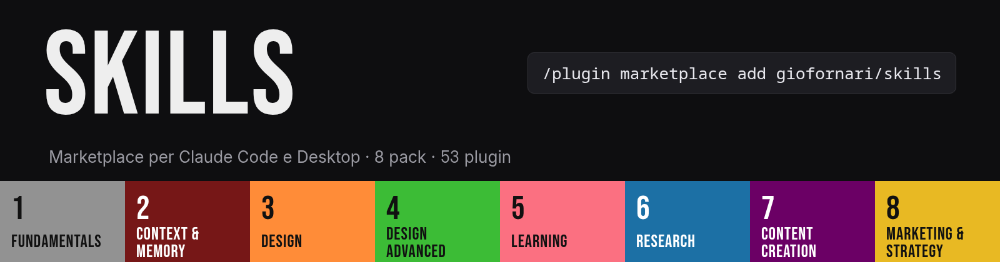
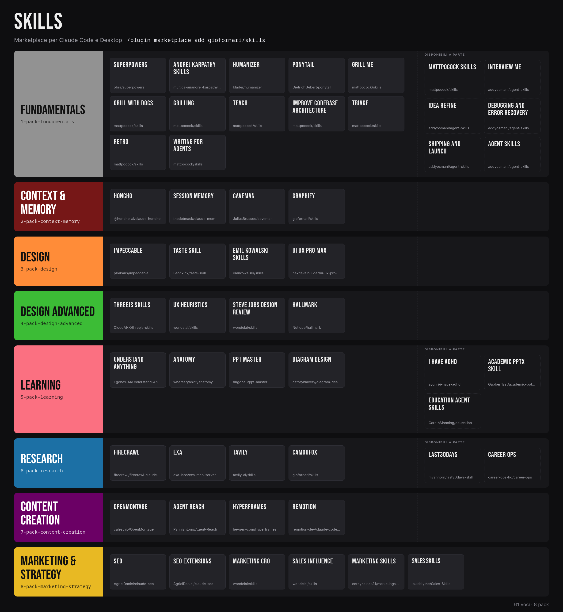
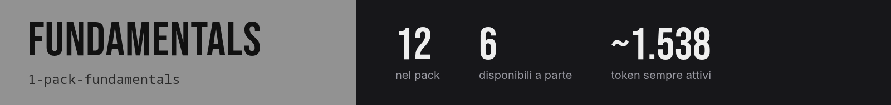
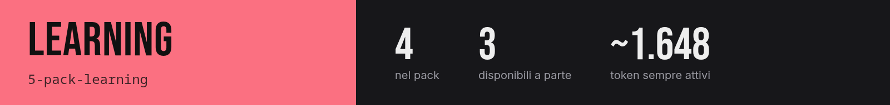

[English](README.md) · **Italiano**

Un **marketplace** per Claude Code e Claude Desktop: un catalogo di plugin. Qui ci sono tutte le skill, i server MCP e gli strumenti che uso, divisi in 7 categorie. Ogni categoria ha un **pack** che installa l'essenziale in un colpo solo. Ogni plugin si installa anche da solo.

Qui non c'è niente di copiato. Ogni voce punta al repo originale e segue l'ultima versione.

## Installa: tu

**Claude Code**

```
/plugin marketplace add giofornari/skills
/plugin install 1-pack-fundamentals@giofornari
```

**Claude Desktop**: Customize > Plugins > Add marketplace > `giofornari/skills`, poi scegli un pack.

Sfoglia tutto con `/plugin`. I pack sono le prime sette voci.

## Installa: un agente

Di' a Claude: *"Installa il marketplace `giofornari/skills` e il pack `<pack>`."* Oppure esegui:

```
claude plugin marketplace add giofornari/skills
claude plugin install <plugin>@giofornari      # aggiungi --scope project per installare solo in un repo
claude plugin list                             # verifica: <plugin>@giofornari risulta abilitato
```

Poi `/reload-plugins` o riavvia la sessione. I nomi dei plugin sono nelle tabelle qui sotto, oppure `claude plugin list --available --json`. Prima leggi i [Prerequisiti](#prerequisiti) per `graphify`, `camoufox`, `agent-reach` e `openmontage`.

## Come funziona

| Percorso | Ruolo |
|---|---|
| `.claude-plugin/marketplace.json` | Il catalogo e unica fonte di verità: prima i pack, poi i plugin per categoria |
| `plugins/` | Solo ciò che è mio: i 7 manifest dei pack, `camoufox` (server MCP), `graphify` (skill di setup) |
| `docs/` | Le immagini di questo README |

Le voci sono di quattro tipi:

- **Pack**: un plugin vuoto le cui `dependencies` sono i suoi membri. Installarlo li installa tutti.
- **Plugin**: un puntatore a un repo originale.
- **Skill estratta**: una sola skill presa da un repo grande, così costa ~20-130 token invece di 1.000+. Il repo intero resta disponibile (`mattpocock-skills`, `agent-skills`).
- **Plugin locale**: vive in `plugins/`.

**Token** è ciò che un plugin aggiunge a ogni sessione prima che tu lo usi, misurato con `claude plugin details`.



## Pack

| Pack | Installa | Token |
|---|---|---|
| `1-pack-fundamentals` | 12 plugin | ~1.538 |
| `2-pack-context-memory` | 4 plugin | ~3.696 |
| `3-pack-design` | 4 plugin | ~3.166 |
| `4-pack-design-advanced` | 4 plugin | ~1.481 |
| `5-pack-learning` | 4 plugin | ~1.648 |
| `6-pack-research` | 4 plugin | ~1.214 |
| `7-pack-content-creation` | 4 plugin | ~19.030 |

I plugin con tag `bonus` e i due plugin dei repo interi non fanno parte di nessun pack.

## Plugin

### Fundamentals



| Plugin | Cosa fa | Carica | Token |
|---|---|---|---|
| [`superpowers`](https://github.com/obra/superpowers) | Framework di skill e metodo di sviluppo: brainstorming, piani, TDD, debug, review | 15 skill | ~706 |
| [`andrej-karpathy-skills`](https://github.com/multica-ai/andrej-karpathy-skills) | Un CLAUDE.md di linee guida dalle note di Karpathy sugli errori tipici degli LLM nel codice | 1 skill | ~66 |
| [`humanizer`](https://github.com/blader/humanizer) | Toglie dal testo i segni di scrittura generata dall'AI | 1 skill | ~90 |
| [`ponytail`](https://github.com/DietrichGebert/ponytail) | Fa ragionare l'agente come il dev senior più pigro: minimo, niente over-engineering | 6 skill | ~430 |
| [`grill-me`](https://github.com/mattpocock/skills/tree/HEAD/skills/productivity/grill-me) | Un'intervista implacabile per affinare un piano o un design | 1 skill | ~17 |
| [`grill-with-docs`](https://github.com/mattpocock/skills/tree/HEAD/skills/engineering/grill-with-docs) | Intervista implacabile che crea anche i documenti (ADR e glossario) mentre procede | 1 skill | ~35 |
| [`grilling`](https://github.com/mattpocock/skills/tree/HEAD/skills/productivity/grilling) | Interroga l'utente senza sconti su un piano, una decisione o un'idea | 1 skill | ~43 |
| [`teach`](https://github.com/mattpocock/skills/tree/HEAD/skills/productivity/teach) | Insegna all'utente una nuova abilità o un concetto, dentro questo workspace | 1 skill | ~18 |
| [`improve-codebase-architecture`](https://github.com/mattpocock/skills/tree/HEAD/skills/engineering/improve-codebase-architecture) | Cerca nel codice occasioni per approfondire i moduli, le presenta in un report HTML e poi le discute | 1 skill | ~46 |
| [`triage`](https://github.com/mattpocock/skills/tree/HEAD/skills/engineering/triage) | Porta issue e PR esterne attraverso una macchina a stati di ruoli di triage, con brief pronti per gli agenti | 1 skill | ~38 |
| [`retro`](https://github.com/mattpocock/skills/tree/HEAD/skills/engineering/retro) | Fa una retrospettiva su una sessione di coding | 1 skill | ~14 |
| [`writing-for-agents`](https://github.com/mattpocock/skills/tree/HEAD/skills/productivity/writing-for-agents) | Come scrivere documenti pensati per gli agenti | 1 skill | ~35 |

**Disponibili a parte** (fuori dal pack, si installano uno per uno):

| Plugin | Cosa fa | Carica | Token |
|---|---|---|---|
| [`mattpocock-skills`](https://github.com/mattpocock/skills) | L'intero repo mattpocock/skills. Il pack installa solo le skill estratte | 27 skill | ~1.169 |
| [`interview-me`](https://github.com/addyosmani/agent-skills/tree/HEAD/skills/interview-me) | Fa emergere ciò che l'utente vuole davvero, non ciò che pensa di dover volere | 1 skill | ~128 |
| [`idea-refine`](https://github.com/addyosmani/agent-skills/tree/HEAD/skills/idea-refine) | Trasforma idee grezze in concetti netti e attuabili, con pensiero divergente e convergente | 1 skill | ~90 |
| [`debugging-and-error-recovery`](https://github.com/addyosmani/agent-skills/tree/HEAD/skills/debugging-and-error-recovery) | Guida un debug sistematico fino alla causa radice | 1 skill | ~95 |
| [`shipping-and-launch`](https://github.com/addyosmani/agent-skills/tree/HEAD/skills/shipping-and-launch) | Prepara i lanci in produzione | 1 skill | ~78 |
| [`agent-skills`](https://github.com/addyosmani/agent-skills) | L'intero repo addyosmani/agent-skills: skill di ingegneria di livello produzione | 34 skill | ~2.947 |

### Context & Memory


| Plugin | Cosa fa | Carica | Token |
|---|---|---|---|
| [`honcho`](https://www.npmjs.com/package/@honcho-ai/claude-honcho) | Memoria persistente per le sessioni di Claude Code con Honcho | 7 skill + MCP | ~167 |
| [`session-memory`](https://github.com/thedotmack/claude-mem/tree/HEAD/plugin) | claude-mem di thedotmack: cattura, comprime e reinietta ciò che l'agente ha fatto tra una sessione e l'altra | 30 skill + MCP | ~2.127 |
| [`caveman`](https://github.com/JuliusBrussee/caveman) | Modalità di output telegrafico e strumenti per risparmiare token | 23 skill | ~1.366 |
| [`graphify`](./plugins/graphify) | Installa Graphify, la CLI che trasforma il codice in un grafo di conoscenza, con il suo installer ufficiale | 1 skill | ~36 |

### Design


| Plugin | Cosa fa | Carica | Token |
|---|---|---|---|
| [`impeccable`](https://github.com/pbakaus/impeccable/tree/HEAD/plugin) | Vocabolario di design per gli agenti: guida con rifinitura e coraggio | 1 skill | ~312 |
| [`taste-skill`](https://github.com/Leonxlnx/taste-skill) | Direzione artistica per siti, pagine prodotto e dashboard (taste-skill v2) | 1 skill | ~243 |
| [`emil-kowalski-skills`](https://github.com/emilkowalski/skills) | Le skill di Emil Kowalski per designer e ingegneri: animazioni, rifinitura UI, design engineering | 16 skill | ~1.902 |
| [`ui-ux-pro-max`](https://github.com/nextlevelbuilder/ui-ux-pro-max-skill) | Intelligenza di design: stili, palette, tipografia e linee guida UX consultabili | 7 skill | ~709 |

### Design Advanced


| Plugin | Cosa fa | Carica | Token |
|---|---|---|---|
| [`threejs-skills`](https://github.com/CloudAI-X/threejs-skills) | Three.js: scena, geometrie, materiali, shader, animazione, postprocessing, React Three Fiber | 13 skill | ~1.034 |
| [`ux-heuristics`](https://github.com/wondelai/skills/tree/HEAD/ux-heuristics) | Valuta e migliora l'usabilità di un'interfaccia con l'analisi euristica | 1 skill | ~157 |
| [`steve-jobs-design-review`](https://github.com/wondelai/skills/tree/HEAD/steve-jobs-design-review) | Rivede design, prodotti e funzioni con gli standard di Steve Jobs: semplicità spietata, focus, eccellenza end-to-end | 1 skill | ~221 |
| [`hallmark`](https://github.com/Nutlope/hallmark/tree/HEAD/skills) | Skill di design contro l'estetica anonima dell'AI | 1 skill | ~69 |

### Learning



| Plugin | Cosa fa | Carica | Token |
|---|---|---|---|
| [`understand-anything`](https://github.com/Egonex-AI/Understand-Anything/tree/HEAD/understand-anything-plugin) | Trasforma qualsiasi codebase in un grafo di conoscenza interattivo da esplorare e interrogare | 9 skill | ~870 |
| [`anatomy`](https://github.com/wheresryan22/anatomy) | Illustrazioni isometriche interattive e dettagliate | 1 skill | ~259 |
| [`ppt-master`](https://github.com/hugohe3/ppt-master/tree/HEAD/skills) | Trasforma documenti o argomenti in presentazioni PowerPoint native | 1 skill | ~139 |
| [`diagram-design`](https://github.com/cathrynlavery/diagram-design) | Design editoriale dei diagrammi | 7 skill | ~380 |

**Disponibili a parte** (fuori dal pack, si installano uno per uno):

| Plugin | Cosa fa | Carica | Token |
|---|---|---|---|
| [`i-have-adhd`](https://github.com/ayghri/i-have-adhd) | Evita che l'agente seppellisca la risposta: risposte adatte all'ADHD | 1 skill | ~67 |
| [`academic-pptx-skill`](https://github.com/Gabberflast/academic-pptx-skill) | Presentazioni accademiche (talk, seminari, tesi): titoli d'azione, argomento strutturato, standard di citazione | 1 skill | ~205 |
| [`education-agent-skills`](https://github.com/GarethManning/education-agent-skills/tree/HEAD/skills) | 165 skill basate su evidenze per insegnanti, dirigenti scolastici ed EdTech: pedagogia, scienze dell'apprendimento, curricolo, valutazione | 165 skill | ~10.262 |

### Research


| Plugin | Cosa fa | Carica | Token |
|---|---|---|---|
| [`firecrawl`](https://github.com/firecrawl/firecrawl-claude-plugin) | Firecrawl: scrape, crawl, ricerca ed estrazione dal web come dati pronti per gli LLM | 3 skill + MCP | ~180 |
| [`exa`](https://github.com/exa-labs/exa-mcp-server) | Ricerca web, deep research ed estrazione di contenuti con Exa | 2 skill + MCP | ~134 |
| [`tavily`](https://github.com/tavily-ai/skills) | Ricerca, estrazione, crawl e research con Tavily | 8 skill | ~900 |
| [`camoufox`](./plugins/camoufox) | Camoufox MCP: navigazione con Firefox anti-rilevamento (navigate, content, screenshot, click, fill, evaluate) | MCP | ~0 |

**Disponibili a parte** (fuori dal pack, si installano uno per uno):

| Plugin | Cosa fa | Carica | Token |
|---|---|---|---|
| [`last30days`](https://github.com/mvanhorn/last30days-skill) | Ricerca qualsiasi argomento su Reddit, X, YouTube e HN negli ultimi 30 giorni | 1 skill | ~67 |
| [`career-ops`](https://github.com/career-ops-hq/career-ops) | Agente AI open source per la ricerca di lavoro | 1 skill | ~75 |

### Content Creation


| Plugin | Cosa fa | Carica | Token |
|---|---|---|---|
| [`openmontage`](https://github.com/calesthio/OpenMontage) | Produzione video agentica OpenMontage: le sue 91 skill. La pipeline completa richiede il progetto clonato | 91 skill | ~7.762 |
| [`agent-reach`](https://github.com/Panniantong/Agent-Reach) | Permette all'agente di leggere e cercare su internet attraverso più piattaforme. Serve la CLI Agent-Reach | 1 skill | ~88 |
| [`hyperframes`](https://github.com/heygen-com/hyperframes) | Scrivi HTML, renderizza video: tutte le skill HyperFrames in un solo bundle | 7 skill | ~551 |
| [`marketing-skills`](https://github.com/coreyhaines31/marketingskills) | Skill di marketing: CRO, copywriting, SEO e altro | 52 skill | ~10.629 |

## Prerequisiti

- `graphify`: serve `uv`. La sua skill installa la CLI con l'installer di Graphify.
- `camoufox`: serve `uv`. Scarica il browser una volta con `uvx camoufox fetch`.
- `agent-reach`: installa la CLI dalla [guida di installazione](https://raw.githubusercontent.com/Panniantong/Agent-Reach/main/docs/install.md). Il pacchetto PyPI con lo stesso nome è un altro progetto.
- `openmontage`: carica solo le skill. La pipeline completa richiede il progetto clonato (Python 3.10+, FFmpeg).
- `exa`, `firecrawl`, `tavily`: al primo uso servono una tua API key o un login.
- `caveman`, `hyperframes`: l'installazione del plugin salta le dipendenze Node, quindi installale a mano quando uno strumento le chiede.

## Aggiornamenti

Nessuna sorgente è bloccata e nessun manifest imposta una `version`, quindi ogni release o commit upstream conta come aggiornamento.

- Claude Code: aggiungi `"autoUpdate": true` al marketplace in `~/.claude/settings.json`:

  ```json
  {
    "extraKnownMarketplaces": {
      "giofornari": {
        "source": { "source": "github", "repo": "giofornari/skills" },
        "autoUpdate": true
      }
    }
  }
  ```

  A mano: `claude plugin marketplace update giofornari`, poi `claude plugin update <plugin>@giofornari`. Gli aggiornamenti si applicano alla sessione successiva o dopo `/reload-plugins`.
- Claude Desktop: Customize > Plugins, attiva **Sync automatically** per questo marketplace.

## Licenze

Ogni plugin mantiene la licenza e gli autori originali. `openmontage` è AGPL-3.0, `education-agent-skills` è CC BY-SA 4.0 e `andrej-karpathy-skills` non ne dichiara una. Il contenuto originale di questo repo (manifest, server `camoufox`, skill `graphify`) è MIT.
