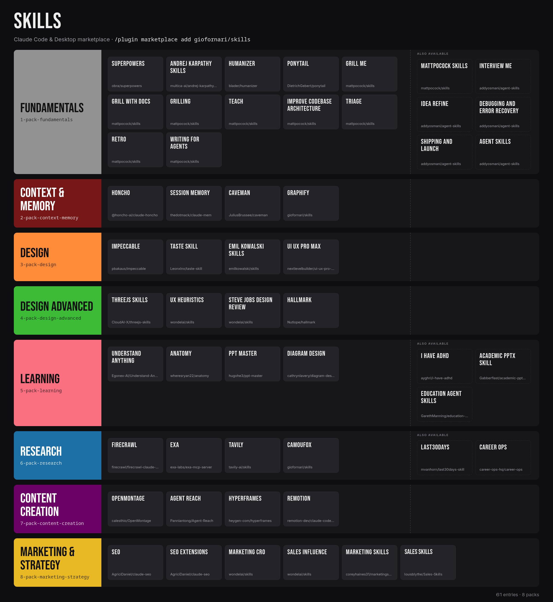

# skills

Curated skills, plugins and MCP servers for Claude Code and Claude Desktop. One **pack** per category installs the essentials in one step; every plugin also installs on its own.



## Install

Claude Code:

```
/plugin marketplace add giofornari/skills
/plugin install pack-fundamentals@giordi
```

Claude Desktop: **Customize > Plugins > Add marketplace**, then `giofornari/skills`.

Packs: `pack-fundamentals`, `pack-context-memory`, `pack-design`, `pack-design-advanced`, `pack-learning`, `pack-research`, `pack-content-creation`. Plugins tagged `bonus` and the full-repo plugins (`mattpocock-skills`, `agent-skills`) belong to no pack. Browse everything with `/plugin`.

## Updates

Every source tracks its upstream default branch (npm for `honcho`); nothing is pinned and no manifest sets a `version`, so a new upstream release or commit counts as an update.

- Claude Code: enable auto-update once, in `~/.claude/settings.json`:

  ```json
  {
    "extraKnownMarketplaces": {
      "giordi": {
        "source": { "source": "github", "repo": "giofornari/skills" },
        "autoUpdate": true
      }
    }
  }
  ```

  By hand: `claude plugin marketplace update giordi`, then `claude plugin update <plugin>@giordi`. Updates apply at the next session or after `/reload-plugins`.
- Claude Desktop: Customize > Plugins, switch on **Sync automatically** for this marketplace, or use **Check for updates**.

## Prerequisites

- `graphify`: needs `uv`; its skill installs the CLI through Graphify's own installer.
- `camoufox`: needs `uv` (runs the bundled server as a script). Fetch the browser once with `uvx camoufox fetch`.
- `agent-reach`: install the CLI from [Agent-Reach's install guide](https://raw.githubusercontent.com/Panniantong/Agent-Reach/main/docs/install.md); the PyPI package of the same name is a different project.
- `openmontage`: loads the skills only; the full pipeline needs the project cloned (Python 3.10+, FFmpeg).
- `caveman`, `hyperframes`: plugin installs skip their Node dependencies (lockfile format), so install those by hand when a tool asks for them.

## Licenses

Each plugin keeps its upstream license and authors; packs only reference them. `openmontage` is AGPL-3.0 and `andrej-karpathy-skills` declares no license. Original content here (manifests, `camoufox` server, `graphify` skill) is MIT.
