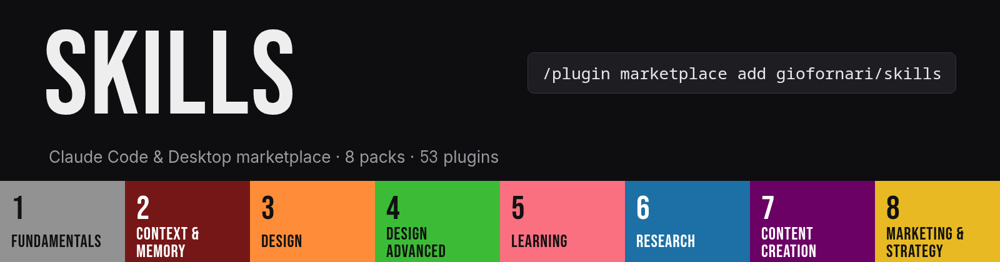

**English** · [Italiano](README.it.md)

A Claude Code and Claude Desktop **marketplace**: a catalog of plugins. This one holds every skill, MCP server and tool I use, sorted into 8 categories. Each category has a **pack** that installs the essentials in one step. Every plugin also installs on its own.

Nothing is copied here. Each entry points at its upstream repo and follows its latest version.

## Install: you

**Claude Code**

```
/plugin marketplace add giofornari/skills
/plugin install 1-pack-fundamentals@giofornari
```

**Claude Desktop**: Customize > Plugins > Add marketplace > `giofornari/skills`, then pick a pack.

Browse everything with `/plugin`. The packs are the first eight entries.

## Install: an agent

Tell Claude: *"Install the marketplace `giofornari/skills` and the pack `<pack>` from it."* Or run:

```
claude plugin marketplace add giofornari/skills
claude plugin install <plugin>@giofornari      # add --scope project to install for one repo only
claude plugin list                             # verify: <plugin>@giofornari is enabled
```

Then `/reload-plugins` or restart the session. Plugin names are in the tables below, or run `claude plugin list --available --json`. Check [Prerequisites](#prerequisites) first for `graphify`, `camoufox`, `agent-reach` and `openmontage`.

## How it works

| Path | Role |
|---|---|
| `.claude-plugin/marketplace.json` | The catalog and single source of truth: packs first, then plugins by category |
| `plugins/` | Only what is mine: the 8 pack manifests, `camoufox` (MCP server), `graphify` (setup skill) |
| `docs/` | The images in this README |

Entries come in four kinds:

- **Pack**: an empty plugin whose `dependencies` are its members. Installing it installs them all.
- **Plugin**: a pointer to an upstream repo.
- **Extracted skill**: one skill pulled out of a big repo, so it costs ~20-130 tokens instead of 1,000+. The full repo stays available too (`mattpocock-skills`, `agent-skills`).
- **Local plugin**: lives in `plugins/`.

**Tokens** is what a plugin adds to every session before you use it, measured with `claude plugin details`.


## Packs

| Pack | Installs | Tokens |
|---|---|---|
| `1-pack-fundamentals` | 12 plugins | ~1,538 |
| `2-pack-context-memory` | 4 plugins | ~3,696 |
| `3-pack-design` | 4 plugins | ~3,166 |
| `4-pack-design-advanced` | 4 plugins | ~1,481 |
| `5-pack-learning` | 4 plugins | ~1,648 |
| `6-pack-research` | 4 plugins | ~1,214 |
| `7-pack-content-creation` | 4 plugins | ~8,578 |
| `8-pack-marketing-strategy` | 6 plugins | ~25,686 |

Plugins tagged `bonus` and the two full-repo plugins belong to no pack.

## Plugins

### Fundamentals


| Plugin | What it does | Loads | Tokens |
|---|---|---|---|
| [`superpowers`](https://github.com/obra/superpowers) | Agentic skills framework and development methodology: brainstorming, plans, TDD, debugging, review | 15 skills | ~706 |
| [`andrej-karpathy-skills`](https://github.com/multica-ai/andrej-karpathy-skills) | One CLAUDE.md of guidelines derived from Karpathy's notes on LLM coding pitfalls | 1 skill | ~66 |
| [`humanizer`](https://github.com/blader/humanizer) | Removes signs of AI-generated writing from text | 1 skill | ~90 |
| [`ponytail`](https://github.com/DietrichGebert/ponytail) | Makes the agent think like the laziest senior dev: minimal, no over-engineering | 6 skills | ~430 |
| [`grill-me`](https://github.com/mattpocock/skills/tree/HEAD/skills/productivity/grill-me) | A relentless interview to sharpen a plan or design | 1 skill | ~17 |
| [`grill-with-docs`](https://github.com/mattpocock/skills/tree/HEAD/skills/engineering/grill-with-docs) | A relentless interview to sharpen a plan or design, which also creates docs (ADR's and glossary) as we go | 1 skill | ~35 |
| [`grilling`](https://github.com/mattpocock/skills/tree/HEAD/skills/productivity/grilling) | Grill the user relentlessly about a plan, decision, or idea | 1 skill | ~43 |
| [`teach`](https://github.com/mattpocock/skills/tree/HEAD/skills/productivity/teach) | Teach the user a new skill or concept, within this workspace | 1 skill | ~18 |
| [`improve-codebase-architecture`](https://github.com/mattpocock/skills/tree/HEAD/skills/engineering/improve-codebase-architecture) | Scan a codebase for deepening opportunities, present them as a visual HTML report, then grill through whichever one you pick | 1 skill | ~46 |
| [`triage`](https://github.com/mattpocock/skills/tree/HEAD/skills/engineering/triage) | Move issues and external PRs through a state machine of triage roles, categorise, verify, grill if needed, and write agent-ready briefs | 1 skill | ~38 |
| [`retro`](https://github.com/mattpocock/skills/tree/HEAD/skills/engineering/retro) | Conduct a retrospective on a coding session | 1 skill | ~14 |
| [`writing-for-agents`](https://github.com/mattpocock/skills/tree/HEAD/skills/productivity/writing-for-agents) | Writing documents for agents | 1 skill | ~35 |

**Also available** (not in the pack, install one by one):

| Plugin | What it does | Loads | Tokens |
|---|---|---|---|
| [`mattpocock-skills`](https://github.com/mattpocock/skills) | The whole mattpocock/skills repo. The pack installs the extracted skills only | 27 skills | ~1,169 |
| [`interview-me`](https://github.com/addyosmani/agent-skills/tree/HEAD/skills/interview-me) | Extracts what the user actually wants instead of what they think they should want | 1 skill | ~128 |
| [`idea-refine`](https://github.com/addyosmani/agent-skills/tree/HEAD/skills/idea-refine) | Refines raw ideas into sharp, actionable concepts through structured divergent and convergent thinking | 1 skill | ~90 |
| [`debugging-and-error-recovery`](https://github.com/addyosmani/agent-skills/tree/HEAD/skills/debugging-and-error-recovery) | Guides systematic root-cause debugging | 1 skill | ~95 |
| [`shipping-and-launch`](https://github.com/addyosmani/agent-skills/tree/HEAD/skills/shipping-and-launch) | Prepares production launches | 1 skill | ~78 |
| [`agent-skills`](https://github.com/addyosmani/agent-skills) | The whole addyosmani/agent-skills repo: production-grade engineering skills | 34 skills | ~2,947 |

### Context & Memory


| Plugin | What it does | Loads | Tokens |
|---|---|---|---|
| [`honcho`](https://www.npmjs.com/package/@honcho-ai/claude-honcho) | Persistent memory for Claude Code sessions using Honcho | 7 skills + MCP | ~167 |
| [`session-memory`](https://github.com/thedotmack/claude-mem/tree/HEAD/plugin) | claude-mem by thedotmack: captures, compresses and re-injects what the agent did across sessions | 30 skills + MCP | ~2,127 |
| [`caveman`](https://github.com/JuliusBrussee/caveman) | Terse output mode and token-saving tooling | 23 skills | ~1,366 |
| [`graphify`](./plugins/graphify) | Sets up Graphify, the codebase knowledge-graph CLI, through its official installer | 1 skill | ~36 |

### Design


| Plugin | What it does | Loads | Tokens |
|---|---|---|---|
| [`impeccable`](https://github.com/pbakaus/impeccable/tree/HEAD/plugin) | Design vocabulary for coding agents: steer with polish and boldness | 1 skill | ~312 |
| [`taste-skill`](https://github.com/Leonxlnx/taste-skill) | Art direction for websites, product pages and dashboards (taste-skill v2) | 1 skill | ~243 |
| [`emil-kowalski-skills`](https://github.com/emilkowalski/skills) | Emil Kowalski's skills for designers and engineers: animation, UI polish, design engineering | 16 skills | ~1,902 |
| [`ui-ux-pro-max`](https://github.com/nextlevelbuilder/ui-ux-pro-max-skill) | Design intelligence: searchable styles, palettes, typography and UX guidelines | 7 skills | ~709 |

### Design Advanced


| Plugin | What it does | Loads | Tokens |
|---|---|---|---|
| [`threejs-skills`](https://github.com/CloudAI-X/threejs-skills) | Three.js: scene, geometry, materials, shaders, animation, postprocessing, React Three Fiber | 13 skills | ~1,034 |
| [`ux-heuristics`](https://github.com/wondelai/skills/tree/HEAD/ux-heuristics) | Evaluate and improve interface usability using heuristic analysis | 1 skill | ~157 |
| [`steve-jobs-design-review`](https://github.com/wondelai/skills/tree/HEAD/steve-jobs-design-review) | Review designs, products, and features with Steve Jobs' standards: ruthless simplicity, focus, and end-to-end excellence | 1 skill | ~221 |
| [`hallmark`](https://github.com/Nutlope/hallmark/tree/HEAD/skills) | Anti-AI-slop design skill | 1 skill | ~69 |

### Learning


| Plugin | What it does | Loads | Tokens |
|---|---|---|---|
| [`understand-anything`](https://github.com/Egonex-AI/Understand-Anything/tree/HEAD/understand-anything-plugin) | Turns any codebase into an interactive knowledge graph you can explore and query | 9 skills | ~870 |
| [`anatomy`](https://github.com/wheresryan22/anatomy) | Detailed interactive isometric illustrations | 1 skill | ~259 |
| [`ppt-master`](https://github.com/hugohe3/ppt-master/tree/HEAD/skills) | Turns documents or topics into native PowerPoint decks | 1 skill | ~139 |
| [`diagram-design`](https://github.com/cathrynlavery/diagram-design) | Editorial diagram design | 7 skills | ~380 |

**Also available** (not in the pack, install one by one):

| Plugin | What it does | Loads | Tokens |
|---|---|---|---|
| [`i-have-adhd`](https://github.com/ayghri/i-have-adhd) | Stops the agent burying the answer: ADHD-friendly responses | 1 skill | ~67 |
| [`academic-pptx-skill`](https://github.com/Gabberflast/academic-pptx-skill) | Academic presentations (talks, seminars, thesis defenses): action titles, structured argument, citation standards | 1 skill | ~205 |
| [`education-agent-skills`](https://github.com/GarethManning/education-agent-skills/tree/HEAD/skills) | 165 evidence-grounded skills for teachers, school leaders and EdTech: pedagogy, learning science, curriculum, assessment | 165 skills | ~10,262 |

### Research


| Plugin | What it does | Loads | Tokens |
|---|---|---|---|
| [`firecrawl`](https://github.com/firecrawl/firecrawl-claude-plugin) | Firecrawl: scrape, crawl, search and extract the web as LLM-ready data | 3 skills + MCP | ~180 |
| [`exa`](https://github.com/exa-labs/exa-mcp-server) | Exa web search, deep research and content extraction | 2 skills + MCP | ~134 |
| [`tavily`](https://github.com/tavily-ai/skills) | Tavily search, extract, crawl and research | 8 skills | ~900 |
| [`camoufox`](./plugins/camoufox) | Camoufox MCP: anti-detect Firefox browsing (navigate, content, screenshot, click, fill, evaluate) | MCP | ~0 |

**Also available** (not in the pack, install one by one):

| Plugin | What it does | Loads | Tokens |
|---|---|---|---|
| [`last30days`](https://github.com/mvanhorn/last30days-skill) | Researches any topic across Reddit, X, YouTube and HN over the last 30 days | 1 skill | ~67 |
| [`career-ops`](https://github.com/career-ops-hq/career-ops) | Open-source AI job search agent | 1 skill | ~75 |

### Content Creation


| Plugin | What it does | Loads | Tokens |
|---|---|---|---|
| [`openmontage`](https://github.com/calesthio/OpenMontage) | OpenMontage agentic video production: its 91 skills. The full pipeline needs the project cloned | 91 skills | ~7,762 |
| [`agent-reach`](https://github.com/Panniantong/Agent-Reach) | Lets the agent read and search the internet across platforms. Needs the Agent-Reach CLI | 1 skill | ~88 |
| [`hyperframes`](https://github.com/heygen-com/hyperframes) | Write HTML, render video: all HyperFrames skills in one bundle | 7 skills | ~551 |
| [`remotion`](https://github.com/remotion-dev/claude-code-plugin) | Remotion: programmatic videos with React. Best practices, captions, rendering, studio and more | 12 skills | ~177 |

### Marketing & Strategy


| Plugin | What it does | Loads | Tokens |
|---|---|---|---|
| [`seo`](https://github.com/AgriciDaniel/claude-seo) | SEO suite: 26 skills and 19 sub-agents for audits, technical SEO, schema, GEO, backlinks, local and e-commerce SEO | 26 skills | ~3,123 |
| [`seo-extensions`](https://github.com/AgriciDaniel/claude-seo/tree/HEAD/extensions) | Optional SEO data skills for Ahrefs, Bing Webmaster, Firecrawl, Matomo, Profound, SE Ranking and Unlighthouse. Each needs its own account or API key | 7 skills | ~414 |
| [`marketing-cro`](https://github.com/wondelai/skills) | Conversion and marketing frameworks: CRO methodology, StoryBrand, Scorecard Marketing, Contagious, 1-Page Marketing Plan | 5 skills | ~788 |
| [`sales-influence`](https://github.com/wondelai/skills) | Sales and persuasion frameworks: Cialdini's influence psychology, Predictable Revenue, Made to Stick, $100M Offers | 4 skills | ~694 |
| [`marketing-skills`](https://github.com/coreyhaines31/marketingskills) | Marketing skills: CRO, copywriting, SEO and more | 52 skills | ~10,629 |
| [`sales-skills`](https://github.com/louisblythe/Sales-Skills) | Sales skills for SDRs, AEs and revenue leaders: prospecting, discovery, objection handling, negotiation, pipeline, AI SDR bots | 122 skills | ~10,038 |

## Prerequisites

- `graphify`: needs `uv`. Its skill installs the CLI through Graphify's own installer.
- `camoufox`: needs `uv`. Fetch the browser once with `uvx camoufox fetch`.
- `agent-reach`: install the CLI from [its install guide](https://raw.githubusercontent.com/Panniantong/Agent-Reach/main/docs/install.md). The PyPI package with the same name is a different project.
- `openmontage`: loads the skills only. The full pipeline needs the project cloned (Python 3.10+, FFmpeg).
- `exa`, `firecrawl`, `tavily`: need your own API key or login at first use.
- `seo`: ships a hook that validates schema markup after each file edit. `seo-extensions`: each skill needs its own account or API key.
- `caveman`, `hyperframes`: plugin installs skip their Node dependencies, so install those by hand when a tool asks.

## Updates

No source is pinned and no manifest sets a `version`, so every upstream release or commit counts as an update.

- Claude Code: add `"autoUpdate": true` to the marketplace in `~/.claude/settings.json`:

  ```json
  {
    "extraKnownMarketplaces": {
      "giofornari": {
        "source": { "source": "github", "repo": "giofornari/skills" },
        "autoUpdate": true
      }
    }
  }
  ```

  By hand: `claude plugin marketplace update giofornari`, then `claude plugin update <plugin>@giofornari`. Updates apply at the next session or after `/reload-plugins`.
- Claude Desktop: Customize > Plugins, switch on **Sync automatically** for this marketplace.

## Licenses

Each plugin keeps its upstream license and authors. `openmontage` is AGPL-3.0, `education-agent-skills` is CC BY-SA 4.0 and `andrej-karpathy-skills` declares none. `remotion` is MIT as a plugin, but the Remotion framework has its own license: free for individuals and small teams, paid for larger companies. The original content here (manifests, `camoufox` server, `graphify` skill) is MIT.
